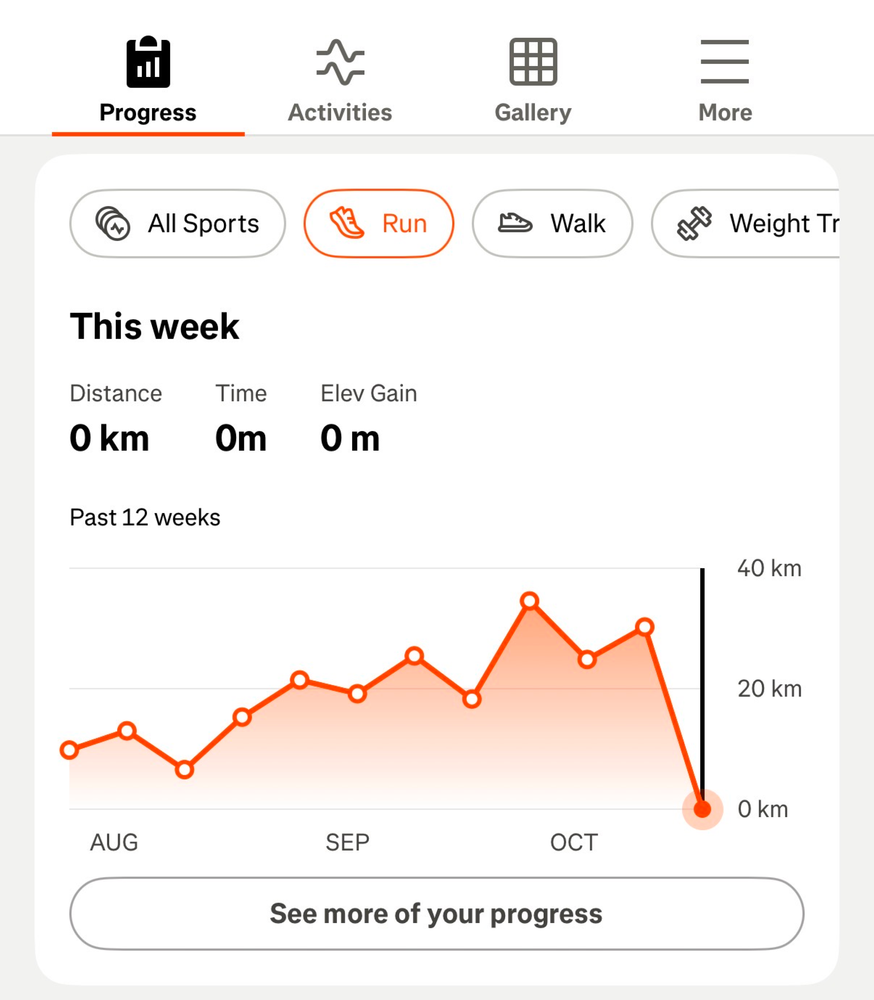
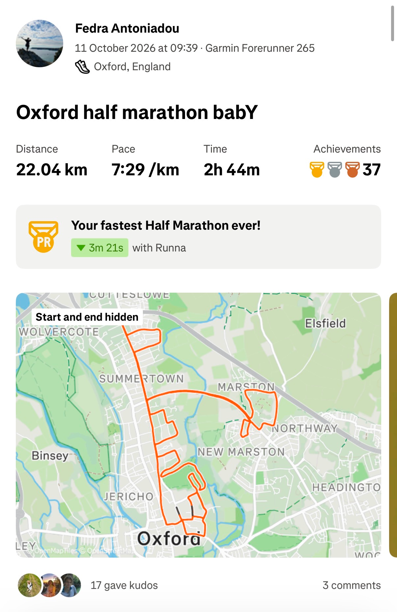
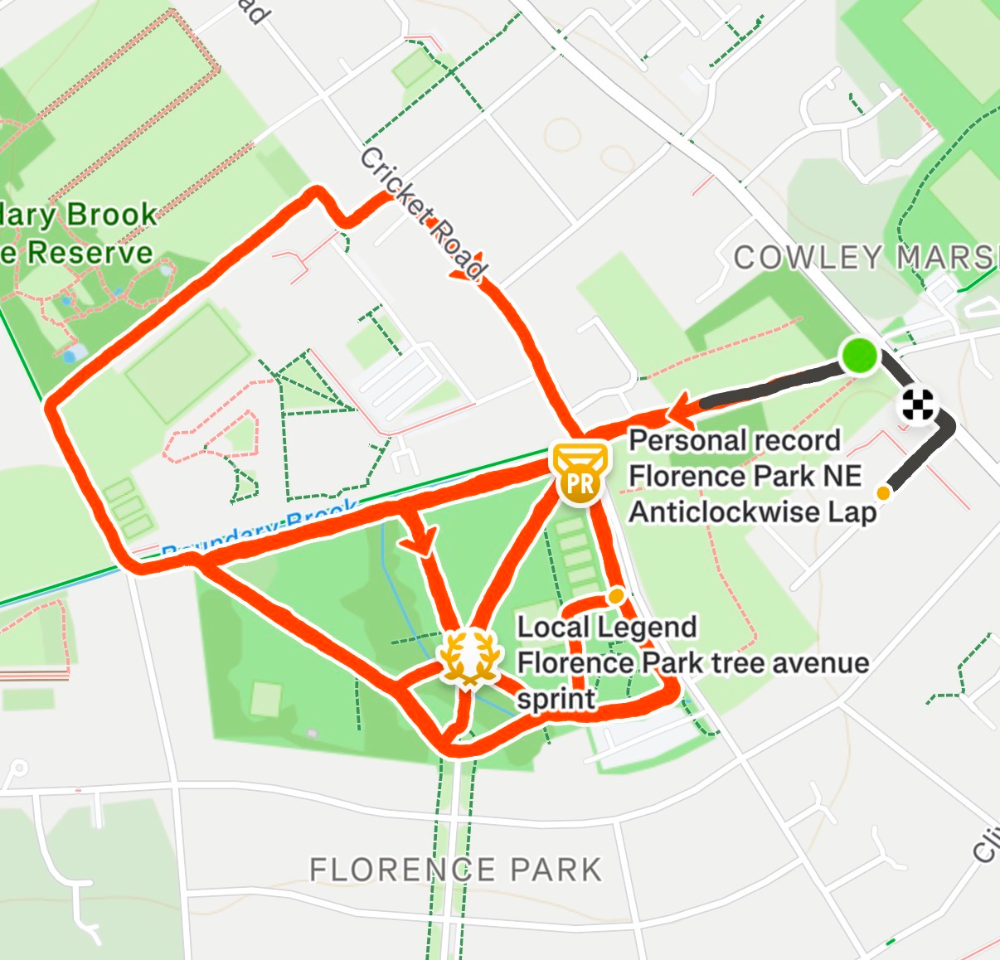

import Figure from "../../components/mdx/Figure.astro";
import Callout from "../../components/mdx/Callout.astro";
import TextBlock from "../../components/mdx/TextBlock.astro";

<TextBlock eyebrow="I'm addicted." title="Why?">
I have been using Strava consistently for about 2 years and I only recently realised that it's as addictive as Instagram and other
similar social media apps. I started using Strava when I first got into running, with the intention of tracking my progress, which the
app makes sure to achieve in several different ways. My aim is to explore these and understand how, and if, they make Strava so
engaging, successful and fun.

</TextBlock>

<TextBlock title="Streaks">

Streak patterns famously increase engagement and drive usage. Streaks manipulate
users using their instinctive senses of loss aversion, pride and fear of missing out.

Within Strava, a streak is the number of consecutive weeks one has logged at least
one activity. Sensibly, this is not measured in days, since users (like me) may find it
impossible to keep up with. Logging at least one activity per week is more
manageable, setting a low effort barrier.

The streak is visually paired with a line graph underneath, which gives a measure of
how much effort (measured in running distance) I put into each week. In that view, the
streak feels real, and earned. My fear of missing out - on keeping up my progress - is
triggered strongly looking at my progress graph drop from the ~30km I was
completing in the last 3 weeks to zero. So, in the back of my mind, going for a run
would be pushed up the priority list in order to avoid losing the progress.

</TextBlock>

<TextBlock>

Even though the effort to maintain a streak is low, the combined effort put into its
length, and the distance shown in the line graph below, is what causes the aversion
for losing it for me. In my opinion, this is what makes the graph visualisation more
impactful than the streak badge under my profile picture.

One common pattern I notice Strava lacks in terms of streaks, is notifications. I am
unsure whether that is a conscious choice, or oversight. Even though there is no
structured plan or weekly goals per se, I would perhaps appreciate a well-timed,
personalised notification reminding me to keep up my progress. For instance, if most
of my logged activities tend to be in the afternoon, I would be (extrinsically) motivated
if I got a notification on a Monday afternoon, asking if I’m up for a short run (but
without going as far as Duolingo as that would be stressful with fitness).

I noticed that the progress graph measures progress in distance for running, walking, cycling and in hours for weight training. While
distance makes sense for cardio, I would think that time for weight training is not as meaningful or earned. A weight training session
might drag due to the gym being busy, someone taking long breaks in between sets, or a fire evacuation in the gym. A session that
would carry greater achievement, though, would be one where a higher weight volume is lifted. Weight lifters usually aim to focus
on an exercise plan, comprising of sets of different exercises (e.g. squats, hip thrusts, etc.). Their aim is to increase the weight lifted
in each of these exercises to gain muscle and so, a graph of total weight volume lifted per week would reflect progress more
accurately. This would perhaps be the case for trail runners, hikers, or mountain bikers who would rather track their progress in
terms of total elevation. Hence, I would add a feature for users to be able to adjust this view.
</TextBlock>

<TextBlock eyebrow="Abundant badges." title="Progress">
To reiterate, I have been using Strava for more than 2 years and have logged over 200
activities, however I never felt like I wasn't seeing progress. This is because the app has
diversified the achievements users are rewarded for with badges, milestones and
leaderboards (though leaderboards are hidden behind a paywall), ensuring no one ever
runs out of achievements.
Using segments and having a leaderboard for each one, makes users very probable to
receive at least one achievement during an activity. For instance, when I logged my half
marathon run I received 37 achievements, of which more than half were me achieving my
best effort on different segments. This didn't surprise me, as I only ever crossed some of
these segments once before. So, completing each of them faster for the second time
ever, awarded me a “PR” badge. Hence, the 37 achievements.

</TextBlock>

<TextBlock flip={true}>
Although the number of achievements is not surprising, receiving instant feedback after
the half marathon made me feel like I’m on the right track and I continued my day with a
more confident and happy mood. Also, these effort results, and tying the activity to a
memory by adding pictures, make the app feel more personal.
The above rankings (“PR”, “2nd best of all time”, etc.) might appeal more to runners who
have a competitive nature, constant ly seeking to beat others, or their own past efforts.
However, the app caters for runners who value consistency over speed by having a
“Local Legend” badge. The badge is awarded to runners who complete segments
frequently. Earning this was a pleasant surprise to me, as I was going for what I thought
was a steady, relaxing jog, having low expectations in terms of results. An unexpected,
different badge to what I’d seen before reinforced the feeling of confidence I described
above, and motivated me to earn it on more segments. I wondered if there were other
badges I hadn’t seen before that I could earn as well. This increased my loyalty to the
platform as I would make sure to maintain my logging cadence on the app to keep
earning badges.

</TextBlock>

<TextBlock>
Similar to the above, perhaps diversifying badges to reward users for elevation, weight volume, and other metrics for other activity
types would work better for users who don’t run, attracting different audiences. Also, having some personalised promspts for users
such as “You’ve only got 2 runs across Florence Park tree avenue sprint to go to become a Local Legend” could reinforce a user’s
motivation to log an activity. There could be an edge case here where fierce competition arises for busy segments. This could end
up not encouraging users to diversify their routes, thus decreasing their likelihood of them earning other badges. I think the
probability of this is low, and if mixed with other similar notifications, it would provide an overall, more personalised experience for
users.
</TextBlock>

<TextBlock title='Conclusion' eyebrow='confidence boost'>
Essentially, there is a slim chance one could stop earning badges, rewards or significantly lose confidence when using Strava. The
slow progression of the app towards something more social, is boosting usage. Continuous display of progress and
personalisation is there to ensure no one wants to leave. Respondents to surveys about Strava reported that it boosted their
confidence, which is unusual for a social media app. Kudos to fitness!
</TextBlock>
